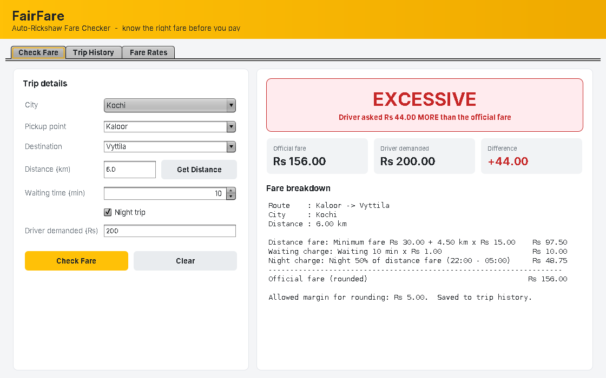
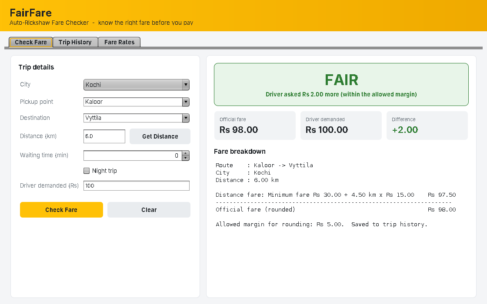
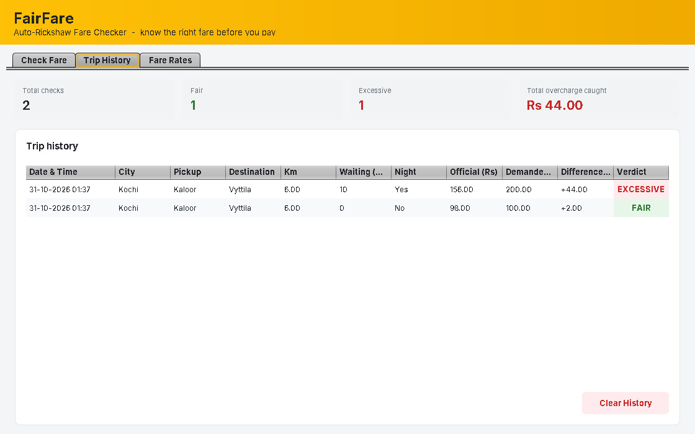
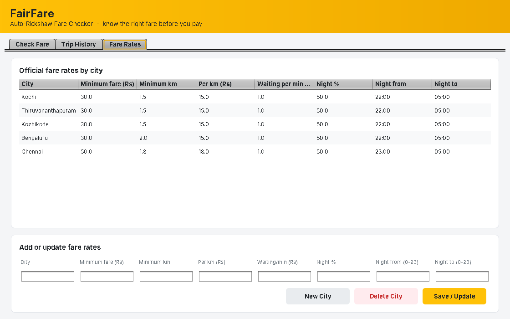

# FairFare – Auto-Rickshaw Fare Checker

A Java desktop (Swing) application that tells a passenger whether the fare an
auto-rickshaw driver is asking for is **FAIR** or **EXCESSIVE**.

Mini project for **PBCST304 – Object Oriented Programming** (3rd semester B.Tech).



## What it does

1. The passenger picks a **city**, a **pickup point** and a **destination**.
2. **Get Distance** looks up the road distance from the built-in route table.
   If the route is unknown, the passenger types the distance in.
3. The app calculates the **official fare** using that city's rates:
   - **Distance fare** = minimum fare + (distance − minimum km) × per-km rate
   - **Waiting charge** = waiting minutes × waiting rate
   - **Night charge** = night % of the distance fare (auto-ticked during the city's night hours)
4. The passenger enters the amount the **driver demanded**.
5. The app shows a verdict: **FAIR** (green) or **EXCESSIVE** (red) with the difference,
   plus a full fare breakdown. A margin of Rs 5 is allowed for rounding.
6. Every check is saved to **Trip History** (`data/history.csv`).
7. Fare rates can be added, updated or deleted per city in the **Fare Rates** tab
   (`data/rates.csv`).

### Worked example (Kochi: Rs 30 for 1.5 km, then Rs 15/km)

| Item | Calculation | Amount |
|---|---|---|
| Distance fare (6 km) | 30 + 4.5 × 15 | Rs 97.50 |
| Waiting (10 min) | 10 × 1 | Rs 10.00 |
| Night charge 50% | 97.50 × 50% | Rs 48.75 |
| **Official fare** | rounded | **Rs 156** |
| Driver demanded | | Rs 200 |
| **Verdict** | 200 > 156 + 5 | **EXCESSIVE by Rs 44** |

## How to run

Needs **JDK 11 or newer** (no other libraries).

```sh
# Linux / macOS
./build.sh
./run.sh

# Windows
build.bat
run.bat
```

Run the fare logic tests:

```sh
java -cp out fairfare.FareLogicTest
```

The app opens with sample rates for Kochi, Thiruvananthapuram, Kozhikode,
Bengaluru and Chennai. These are sample values — update them in the
**Fare Rates** tab to match the latest government notification.

## Project structure

```
src/fairfare/
├── Main.java                       Entry point: creates objects, opens window
├── model/
│   ├── CityRate.java               Fare rates of one city (encapsulation + validation)
│   ├── TripRequest.java            Details entered by the passenger
│   ├── Trip.java                   One saved fare check (immutable)
│   ├── FareBreakdown.java          Lines of the fare + total
│   └── Verdict.java                enum: FAIR / EXCESSIVE
├── charges/
│   ├── Charge.java                 abstract class for one part of the fare
│   ├── BaseFareCharge.java         minimum fare + per-km
│   ├── WaitingCharge.java          waiting minutes × rate
│   └── NightCharge.java            night % of distance fare
├── service/
│   ├── FareCalculator.java         interface
│   ├── AutoFareCalculator.java     adds up a List<Charge> (polymorphism)
│   ├── DistanceProvider.java       interface
│   ├── RouteTableDistanceProvider.java  built-in route distances
│   ├── FareChecker.java            gives the verdict
│   └── FareService.java            connects everything for the UI
├── storage/
│   ├── CsvFileStore.java           abstract generic class: save/load CSV files
│   ├── RateRepository.java         city rates  -> data/rates.csv
│   └── TripHistory.java            fare checks -> data/history.csv
├── exception/
│   ├── InvalidInputException.java
│   └── RouteNotFoundException.java
└── ui/
    ├── MainFrame.java              window with 3 tabs
    ├── CheckFarePanel.java         Check Fare tab
    ├── HistoryPanel.java           Trip History tab
    ├── RatesPanel.java             Fare Rates tab
    ├── Refreshable.java            interface for tabs that reload data
    ├── HeaderPanel.java            yellow title strip
    ├── RoundedPanel.java           card panel (overrides paintComponent)
    ├── StatCard.java               small caption + value card
    ├── StyledButton.java           button (overrides paintComponent)
    └── Theme.java                  colours and fonts
test/fairfare/FareLogicTest.java    13 tests for the fare logic
```

## OOP concepts used

| Concept | Where to find it |
|---|---|
| **Class & Object** | `CityRate`, `Trip`, `TripRequest` objects are created for every city / check |
| **Encapsulation** | Private fields with getters/setters in `CityRate`; setters reject negative fares and invalid hours. `Trip` is immutable. `FareBreakdown.getLines()` returns a read-only list |
| **Abstraction** | `abstract class Charge`, `abstract class CsvFileStore<T>`; interfaces `FareCalculator`, `DistanceProvider` |
| **Inheritance** | `BaseFareCharge`, `WaitingCharge`, `NightCharge` extend `Charge`; `RateRepository`, `TripHistory` extend `CsvFileStore`; `MainFrame extends JFrame`; `RoundedPanel extends JPanel`, `StatCard extends RoundedPanel`; custom exceptions extend `Exception` |
| **Method overriding** | `calculate()` / `describe()` in each `Charge` subclass; `paintComponent()` in `RoundedPanel` and `StyledButton`; `toString()` in `CityRate` |
| **Polymorphism (runtime)** | `AutoFareCalculator` loops over `List<Charge>` and calls `calculate()` – each subclass runs its own version. `MainFrame` calls `refresh()` on any `Refreshable` tab |
| **Interfaces** | `FareCalculator`, `DistanceProvider`, `Refreshable` |
| **Composition** | `FareService` has a `DistanceProvider`, `FareCalculator`, `FareChecker`, `RateRepository`, `TripHistory`; `NightCharge` has a `BaseFareCharge` |
| **Exception handling** | Custom checked exceptions `InvalidInputException`, `RouteNotFoundException`; try/catch in the UI; try-with-resources for files |
| **Enum** | `Verdict` with a label for each value |
| **Generics & Collections** | `CsvFileStore<T>`, `ArrayList`, `HashMap`, `LinkedHashMap`, `TreeSet` |
| **File I/O** | `BufferedReader` / `BufferedWriter` in `CsvFileStore` |
| **Event handling (GUI)** | Swing `ActionListener`s (lambdas) on buttons, combo boxes and tabs |

## Screenshots

| Fair | Excessive |
|---|---|
|  |  |

| Trip History | Fare Rates |
|---|---|
|  |  |
